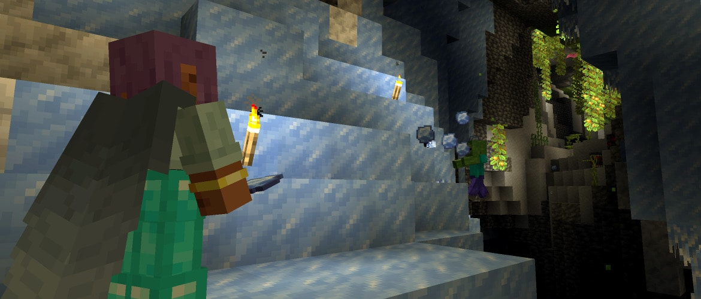

## [Minecraft 26.4 Snapshot 9 & 10](https://www.minecraft.net/en-us/article/minecraft-26-4-snapshot-9)
- Vulkan devient l'API graphique par défaut et n'est plus expérimental
- Ajout du réglage « Brouillard amélioré », indépendant de « Transparence améliorée » et activé par défaut sauf avec les graphismes Rapides
- L'accélération des cochons et des arpenteurs dure entre 7 et 35 secondes
- Le feu et le feu des âmes émettent un son d'extinction lorsqu'ils sont détruits
- Le livre de recettes et l'inventaire Créatif sont utilisables au clavier et lus par le narrateur
- Les onglets du livre de recettes affichent leur catégorie en infobulle et les recettes sont surlignées au survol ou à la sélection
- La touche de répétition, R par défaut, répète la dernière recette ou le dernier échange
- Actualisation plus fiable de la disponibilité des amis
- DP version 128.0 :
  - Ajout du registre `dispense_behavior` et du composant `minecraft:dispense_behavior`, qui personnalisent les actions des distributeurs, essayées successivement jusqu'à ce que l'une réussisse
  - Les objets de bateaux et de wagonnets possèdent maintenant par défaut le composant `minecraft:entity_data`, déterminant l'entité placée
  - Les commandes `/forceload`, `/spreadplayers` et `/worldborder center` acceptent les coordonnées locales 2D
  - Ajout du transformateur de blocs `minecraft:honeycomb`, qui permet de cirer des blocs depuis un distributeur
  - Ajout du champ `radius` à la particule `minecraft:current_down`, qui définit son rayon d'apparition autour de la position indiquée
  - Ajout du champ optionnel `pop_chance` à la particule `minecraft:bubble_column_up`, qui définit la probabilité d'émettre une particule et un son d'éclatement à la fin de sa durée de vie
  - Les champs de saisie des dialogues affichent le texte en rouge et une infobulle d'avertissement lorsqu'une adresse e-mail semble être saisie
- RP version 104.0 :
  - Les clés de traduction commençant par `menu.custom_options` ou `menu.custom_screen_info` ne sont plus remplaçables
  - Ajout des textures `recipe_book/slot_highlight_back.png` et `recipe_book/slot_highlight_front.png` pour surligner les recettes
- Modification de l'établissement des clés de chiffrement à la connexion
- Ajout de la propriété serveur `key-rotation-period-seconds`, définissant l'intervalle minimal de renouvellement des clés, par défaut 60 secondes
- [65 bugs fixés](https://mojira.dev/?project=MC&fix_version=26.4%20Snapshot%209)
- Bug fixé pour la Snapshot 10 : [MC-313265](https://mojira.dev/MC-313265) - Le jeu plante lorsque l'on fait défiler le menu multijoueur
