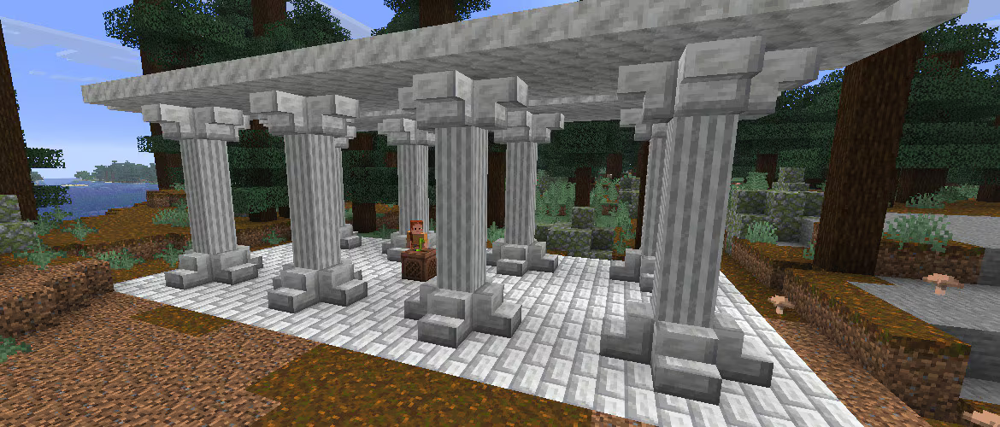

## [Minecraft 26.4 Snapshot 7](https://www.minecraft.net/en-us/article/minecraft-26-4-snapshot-7)
- Ajout d'ensembles de blocs en calcite :
  - La calcite possède maintenant des variantes en pilier, dalle, escalier et muret
  - La calcite polie se fabrique avec quatre blocs de calcite disposés en carré et possède des variantes en dalle, escalier et muret
  - Les briques de calcite polie se fabriquent avec quatre blocs de calcite polie disposés en carré et possèdent également ces trois variantes
  - Toutes ces variantes peuvent être fabriquées au tailleur de pierre
  - La calcite, la calcite polie et les briques de calcite polie correspondent à l'archétype de cube de soufre lent et rebondissant
- Ajout du disque de musique "Flurry" de Hyper Potions, trouvable dans les coffres du sous-sol des igloos et produisant un signal de comparateur de 7 dans un jukebox
- Ajout du bloc de schiste des âmes scuplté
- Modification du panorama du menu principal
- Être en feu protège maintenant de l'effet Gel de la même manière qu'une armure en cuir
- Porter au moins une pièce d'armure en cuir empêche maintenant les zombies et les squelettes de devenir des Givrés ou des Vagabonds
- Les Vagabonds peuvent maintenant apparaître dans les océans gelés et leurs variantes profondes, les pics gelés ou dentelés, les rivières gelées et les pentes enneigées
- Lorsque le réglage vidéo API graphique est défini sur Par défaut, le jeu choisit maintenant aléatoirement OpenGL ou Vulkan à chaque démarrage
- Les boutons Jouer des menus Realms sont maintenant violets
- Amélioration de la navigation au clavier dans les interfaces :
  - Les écrans de jeu, comme les établis, peuvent maintenant être parcourus et utilisés au clavier, à l'exception de l'inventaire Créatif et du livre de recettes
  - Tabulation sélectionne les groupes d'emplacements, les flèches se déplacent à l'intérieur et Entrée ou Espace permettent d'effectuer les actions de la souris
  - Le narrateur lit maintenant le contenu, l'infobulle, le nom et la position des emplacements ainsi que les instructions de navigation
  - Le curseur est masqué pendant la navigation au clavier et les flèches sélectionnent désormais les champs de saisie sans les éditer, contrairement à Tabulation
- DP version 126.0 :
  - La commande `/effect` accepte maintenant les tags d'effets de statut
  - Les arguments temporels sont maintenant refusés lorsque leur valeur en ticks dépasse 2 147 483 647
  - Les mondes de débogage :
    - Peuvent maintenant être modifiés normalement et contiennent un exemplaire de chaque type d'entité, avec une version bébé lorsqu'elle existe
    - Ils se chargent avec les ticks gelés en difficulté Normale et avec les règles de jeu `advance_time`, `advance_weather`, `spawn_wandering_traders` et `tnt_explodes` désactivées
    - Leurs blocs ne sont plus actualisés automatiquement ; un nouveau monde doit être créé pour afficher les nouveaux blocs
  - Suppression des tags de types d'entités inutilisés `#swimming` et `#flying` ainsi que de l'ensemble de sons de blocs `minecraft:twisting_vines`
- RP version 102.0 :
  - Les cinq textures de stalactites de glace `block/icicle_down_*.png` ont été renommées en retirant `down_` de leur nom
  - Ajout des textures des nouveaux blocs de calcite et du disque de musique "Flurry"
  - Ajout de l'événement sonore `entity.parrot.imitate.frostbite`, joué lorsqu'un perroquet imite un Givré
- [53 bugs fixés](https://mojira.dev/?project=MC&fix_version=26.4%20Snapshot%207)
